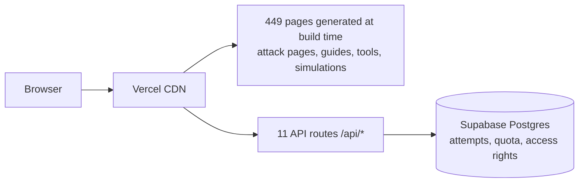

# Cybersecu

**Learn to recognise online scams and cyberattacks by practising on realistic, harmless simulations.**

Cybersecu ([www.cybersecu.app](https://www.cybersecu.app)) is a cybersecurity education platform for the general public. It explains how common attacks work (phishing, smishing, fake tech support, bank impersonation, account takeover and more) and lets people practise spotting them in interactive simulations, without an account. The site is in French and English.

> **Status:** live in production. The repository is private and has no licence file: the code is not open source.

## Why it exists

Most scam victims are not careless. They are rushed, frightened or flattered at the wrong moment. Reading a list of warning signs rarely helps when a convincing text message arrives. Cybersecu trains the reflex instead: you see a realistic message, you choose what to do, and you get an explanation of the technique, the clue you could have spotted, the risk, and the right reflex.

## Who it is for

- People who want to understand an attack they have just received, or to avoid the next one.
- Seniors, and the families and caregivers who help them.
- Teachers, associations and awareness trainers looking for concrete examples.
- Small businesses: transfers, invoices and staff awareness.

## What you can do on the site

| Feature | What it is |
| --- | --- |
| **Attack encyclopedia** | 100 attack pages in 10 families (social engineering, financial fraud, accounts and passwords, malware, phones and connected devices, networks and Wi-Fi, data and identity, AI and synthetic content, and more). Each page gives a simple and a full definition, how the attack unfolds, warning signs, how to check, what to do, what to do if you are a victim, and sources |
| **Interactive simulations** | 64 scenarios in each language (SMS, email, phone calls, fake websites). Every choice is explained. The content is entirely fictional: no real brand domain, no real message |
| **Practical guides** | 9 step-by-step guides, for example what to do after giving your bank details or a code |
| **Psychological levers** | 9 pages on the levers scammers use: urgency, authority, fear… |
| **Free tools** | Suspicious message analyser, link decoder, "I clicked" assistant, emergency checklist, "X or Y?" comparisons, password and passphrase generator, printable checklists for seniors, families and small businesses |

**No account is needed.** The first 10 simulations are free. Paid access exists in the code but **sales are currently closed**.

## How it works



- **The content lives in this repository**, not in a database (`src/content/`, [decision 0007](docs/decisions/0007-content-in-repository.md)). Every public page is generated at build time and served from the CDN. Reading a page never queries the database.
- **The tools run in the browser.** What you paste into the message analyser or the link decoder is never sent to a server. The password generator uses `crypto.getRandomValues` and never transmits or stores what it generates ([threat model](docs/security/PASSWORD_GENERATOR_THREAT_MODEL.md)).
- **Simulations are graded on the server**, so the correct answer is not in the page before you choose. An anonymous, signed cookie counts your free simulations. It is created only when you start your first simulation ([no-login architecture](docs/NO_LOGIN_ARCHITECTURE.md)).

## Languages

French (`/`) and English (`/en/`). Every attack page, guide, lever, tool and simulation exists in both languages, linked with `hreflang`.

## Technology

| Layer | Choice |
| --- | --- |
| Framework | Next.js 16 (App Router, Turbopack), React 19, TypeScript |
| Styling | Tailwind CSS 4, `class-variance-authority`, `lucide-react`, `motion` |
| Validation | zod |
| Data | Supabase (Postgres via its REST API) for attempts, quota and access rights only |
| Payments, email | Stripe (Payment Link and signed webhook; sales closed), Resend (access recovery email) |
| Hosting | Vercel |
| Tests and CI | Vitest, ESLint, `tsc`, SEO and build-size checks, run by GitHub Actions on every pull request |
| Package manager | pnpm 10 |

## Getting started

Prerequisites: Node.js 22 (the version CI uses) and pnpm 10.

```bash
pnpm install
pnpm dev          # http://localhost:3000
```

That is the whole setup for the public site: every content page renders with no database, no environment variable and no SQL step.

### Environment variables

Every variable is declared once, in [`src/lib/env/registry.ts`](src/lib/env/registry.ts): its canonical name, accepted legacy aliases, whether it is required, and what breaks without it. `.env.example` is **generated** from that registry (`pnpm env:example`), and a unit test fails if the two drift apart. None of these variables is needed to render the public pages.

`SITE_URL` feeds every canonical tag, the sitemap and robots.txt. It defaults to `https://www.cybersecu.app`, the host production serves. Set it explicitly in any other environment.

### Database (only needed to play a simulation)

The database records attempts, enforces the free quota and honours purchases. Without it, the content pages still render; only the simulation player stops working.

Paste [`supabase/bootstrap.sql`](supabase/bootstrap.sql) into the Supabase SQL Editor, or run `psql "$SUPABASE_DB_URL" -f supabase/bootstrap.sql`. It concatenates every migration in order (`pnpm db:bootstrap` regenerates it). It is replayable and non-destructive: every statement is guarded, and no existing row is deleted. Then check the result with:

```bash
pnpm db:doctor    # read-only: what the public identity can see
```

`GET /api/health` reports the same thing from a running deployment: content counts, and database reachability reported separately.

### Scripts

```bash
pnpm build          # production build
pnpm test           # unit tests (vitest)
pnpm typecheck      # tsc --noEmit
pnpm lint           # eslint
pnpm seo:audit      # content and link integrity report
pnpm seo:metadata   # titles, descriptions, canonicals (after a build)
pnpm seo:images     # alt text, dimensions, image references (after a build)
pnpm size:check     # build-output budget (after a build)
pnpm env:example    # regenerate .env.example from the registry
pnpm db:bootstrap   # regenerate supabase/bootstrap.sql
```

### Where the content lives

| What | Where |
| --- | --- |
| The ten families | `src/domain/attack/categories.ts` |
| Attack pages | `src/content/attacks/` |
| Simulations | `src/content/simulations/`, `src/content/simulations-en/` |
| Psychological levers | `src/content/levers/` |
| Guides | `src/content/guides/` |
| Tools | `src/content/tools/`, `src/components/tools/` |
| Slug redirects | `src/content/redirects.ts` |
| URL registry (feeds the sitemap) | `src/domain/seo/indexability.ts` |

Structural faults fail the build instead of reaching production. These include a duplicate slug, a dangling internal link, an entry too thin to publish, two entries whose prose has converged above 85 %, a one-way "related attack" link, an orphan page, and a simulated URL outside the reserved `.test` domain.

## Security, privacy and responsible use

- **Simulations are fictional training material.** They never use a real company's domain, and they never ask you to type anything. A simulation is played by choosing between options.
- **The tools explain; they do not certify.** The message analyser and the link decoder show the warning signs they find. They never say that a message or a link is "safe". When in doubt, contact the organisation through a channel you already know.
- **No tracking.** No analytics provider is loaded today. Product events are typed codes, never free text ([analytics audit](docs/analytics/ANALYTICS_AUDIT.md)). Read the [privacy policy](https://www.cybersecu.app/confidentialite) for details.
- Security model: [`docs/SECURITY_MODEL.md`](docs/SECURITY_MODEL.md).

## Documentation

- [`docs/ARCHITECTURE.md`](docs/ARCHITECTURE.md): stack, routing, rendering strategy.
- [`docs/decisions/`](docs/decisions/): architecture decision records.
- [`docs/SECURITY_MODEL.md`](docs/SECURITY_MODEL.md): security model, RLS, input handling.
- [`docs/SCENARIO_ENGINE.md`](docs/SCENARIO_ENGINE.md), [`docs/LEARNING_ENGINE.md`](docs/LEARNING_ENGINE.md): simulations and scoring.

## Contact

Cybersecu is published by Mountaga Diallo. The contact details and legal information are on the [About page](https://www.cybersecu.app/a-propos#editeur) and in the [terms of use](https://www.cybersecu.app/conditions-utilisation).
